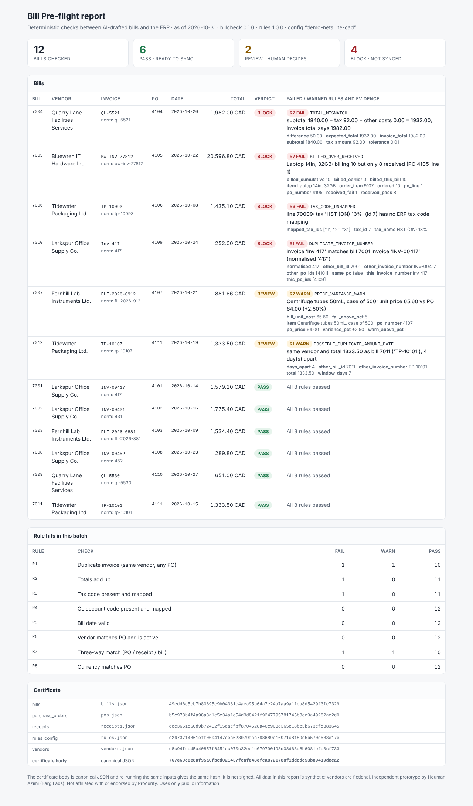

# Bill Pre-flight: deterministic checks between AI-drafted bills and the ERP

A weekend prototype. It takes a batch of draft bills (as an AI extraction step would produce them), checks each one against its purchase orders, receipts and ERP mappings with eight fixed rules, and gives each bill a verdict with the evidence behind it: **PASS** (safe to sync), **REVIEW** (a person decides) or **BLOCK** (do not sync). Retries to the ERP are idempotent, so a timeout followed by a retry does not create a second bill.

Models propose; deterministic checks decide.



## The problem

These are Procurify's own public sources.

- On 20 July 2026 Procurify launched its agentic procurement platform. It says the rebuilt AP engine "captures key invoice details with more than 99% accuracy" and matches and codes invoices against purchase and vendor history. It describes the shift from "AI that suggests" to "AI that acts". ([press release](https://www.procurify.com/press_release/procurify-launches-agentic-procurement-platform-that-acts-on-your-own-spend-data))
- Invoice Inbox turns emailed invoices into draft bills: "AI invoice extraction pre-populates header and line-level data, so reviewers verify rather than re-key." ([AP Automation: Invoice Inbox](https://success.procurify.com/en/articles/9001737))
- Procurify flags a duplicate invoice number when it "matches an existing one for the same purchase order". The article does not describe a check across POs. ([duplicate invoice numbers](https://success.procurify.com/en/articles/14479075-how-to-handle-duplicate-invoice-numbers-in-procurify))
- To stop duplicate bills syncing into NetSuite, Procurify advises turning on NetSuite's "Treat Warnings as Errors" SOAP preference. ([preventing duplicate bills](https://success.procurify.com/en/articles/14114562-preventing-duplicate-bills-by-treating-warnings-as-errors-in-netsuite))
- After a "NetSuite was too slow to respond" error, refreshing the sync while the bill is still in NetSuite's queue means "a duplicate bill will be created". Procurify says this error occurs only in a NetSuite sandbox, not in production. The pattern still matters for any ERP write: the write can succeed while the reply is lost. ([too slow to respond](https://success.procurify.com/en/articles/9001976-netsuite-bills-error-message-netsuite-was-too-slow-to-respond))
- NetSuite rejects bills with a missing tax code ("Please enter value(s) for: Tax Code"), often because of tax code mapping, and bills dated too early ("The bill date must be on or after a specific date"). ([bill creation errors](https://success.procurify.com/en/articles/10446482-troubleshooting-netsuite-bill-creation-errors))

At 99% field accuracy, roughly 1 bill in 100 still has something wrong, and a single bill has many fields. When the AI acts rather than suggests, something deterministic should sit between the draft and the ledger. It should give the same answer every time, show its evidence, and make retries safe.

## What it does

`billcheck check` runs eight rules on every bill. Each rule returns PASS, WARN or FAIL, plus evidence.

| # | Rule | FAIL (default) | WARN (default) |
|---|------|----------------|----------------|
| R1 | Duplicate invoice, same vendor, **any PO** | same normalised invoice number as an earlier bill | same vendor, same total to the cent, invoice dates within 7 days, different number |
| R2 | Totals add up | qty x unit cost != line total; lines != subtotal; line taxes != tax; subtotal + tax + other costs != invoice total (each comparison allows 0.01) | tax-inclusive lines (not checked) |
| R3 | Tax code present and mapped to an ERP tax code | missing; unmapped | line rate differs from mapped rate |
| R4 | GL account code present and mapped | missing; unmapped; inactive | |
| R5 | Bill date | missing; after the as-of date; posting date in a closed period | before the PO date (after-the-fact POs exist) |
| R6 | Vendor matches PO vendor and is active | mismatch; inactive; PO not found | active status unknown |
| R7 | Three-way match per line | cumulative billed qty > received (pass) qty; > ordered qty; unit price more than 5% off PO | unit price 1-5% off PO; line not linked to a PO line |
| R8 | Currency matches PO | mismatch; missing | |

Per bill: **BLOCK** if any FAIL, **REVIEW** if any WARN, **PASS** otherwise. Every finding code's severity can be changed in config (`severity_overrides`, e.g. `{"BEFORE_PO_DATE": "FAIL"}`).

**Invoice number normalisation (R1 and the idempotency key).** These steps run in order:

1. Unicode NFKC, then case-fold.
2. Split into tokens. A token is a run of letters or a run of digits, and a letter/digit boundary also splits. Every other character (space, `-`, `/`, `.`, `#`, `_`) is a separator.
3. Strip leading zeros from digit tokens.
4. Drop leading tokens in `ignore_prefixes` (default `invoice`, `inv`, `no`) while more than one token remains.
5. Join the tokens with `-`.

So `INV-00417`, `Inv 417`, `inv#417`, `Invoice No. 417` and `417` all become `417`, and `INV-0001` equals `inv1`. `FLI-2026-0881` equals `fli 2026/881` but not `FLI-2026881`, because token boundaries are kept. The check is always scoped to one vendor.

**Ordering.** "Earlier" means a lower Procurify bill id (creation order). The first copy of a duplicate passes and later copies are blocked. R7 counts quantities billed on earlier bills in the batch, so two bills that are fine on their own still block if together they over-bill a line.

**Certificate.** `--out report.json` writes a JSON certificate. Its `body` holds the rules version, the SHA-256 of the config and of every input file (by file name), the as-of date, per-rule fail/warn counts, and every bill's verdict, findings and idempotency key. `body_sha256` is the SHA-256 of the canonical JSON of the body (sorted keys, no whitespace, UTF-8). `generated_at` sits outside the body, so re-running the same inputs gives a byte-identical body and the same hash. The "as of" date is fixed in config rather than read from the clock for the same reason. `billcheck verify report.json --input bills.json ...` recomputes the hash and re-hashes the input files. **The certificate is not signed.** The hash shows the body has not changed, but it does not show who produced it.

**HTML report.** `--html report.html` writes a single file with inline CSS, no scripts and no external requests. It contains no timestamp, so it is byte-identical across runs too.

**Idempotent sync.** `billcheck sync` syncs only PASS bills into `MockERP`, an in-process stand-in for NetSuite. MockERP can be made to time out on chosen writes, either after committing the bill (the reply is lost) or before (the write is lost). Each bill gets a deterministic key, `BPF-` plus the first 32 hex characters of SHA-256 over `vendor id | normalised invoice number | invoice total`. The idempotent syncer:

1. records the key as *pending* in a local ledger (persisted with `--ledger`);
2. before every write, including the first, looks the key up in the ERP. If it finds it, it records *synced* and does not write;
3. otherwise it creates the bill with `externalId = key`;
4. on timeout, it repeats from step 2.

A write that landed is found on retry, and a write that was really lost is retried. The naive syncer resends the create and duplicates the bill. NetSuite records support `externalId`, which is what a real integration would key on, but nothing here calls NetSuite.

## 2-minute demo

```bash
cd bill-preflight
python3 -m venv .venv && . .venv/bin/activate     # Python 3.11+
pip install -e '.[test]'                           # no runtime dependencies; pytest for tests
./demo/run_demo.sh                                 # also writes demo/demo_output.txt
open demo/report.html                              # or xdg-open
pytest -q                                          # 71 tests
```

The demo has 12 synthetic AI-drafted bills from 5 fictional vendors, plus 11 POs and 15 receipt rows. The results are 6 PASS, 2 REVIEW and 4 BLOCK, each block for a different reason:

| Bill | Verdict | Why |
|------|---------|-----|
| 7010 | BLOCK | `Inv 417` = `INV-00417` (bill 7001) after normalisation, same vendor, **different PO** (4109 vs 4101). Procurify's documented same-PO check would not catch this. |
| 7004 | BLOCK | Invoice total drafted as 1,982.00. Subtotal 1,840.00 + tax 92.00 = 1,932.00, so it looks like a misread digit. |
| 7006 | BLOCK | Tax "HST (ON) 13%" (id 7) has no ERP tax code mapping. NetSuite would reject it with "Please enter value(s) for: Tax Code". |
| 7005 | BLOCK | Bills 10 laptops; 8 received in good condition (1 damaged, 1 backordered). |
| 7007 | REVIEW | Unit price 65.60 vs PO 64.00 (+2.50%). |
| 7012 | REVIEW | Same vendor and total as 7011, 4 days apart, different invoice number. It is probably a second delivery against a standing order, but a person should confirm. |

## Sample output

From [`demo/demo_output.txt`](demo/demo_output.txt):

```
BILL  VENDOR                          INVOICE        PO           TOTAL CUR  VERDICT
------------------------------------------------------------------------------------
7004  Quarry Lane Facilities Services QL-5521        4104      1,982.00 CAD  BLOCK
      R2 FAIL TOTAL_MISMATCH: subtotal 1840.00 + tax 92.00 + other costs 0.00 = 1932.00, invoice
          total says 1982.00
7005  Bluewren IT Hardware Inc.       BW-INV-77812   4105     20,596.80 CAD  BLOCK
      R7 FAIL BILLED_OVER_RECEIVED: Laptop 14in, 32GB: billing 10 but only 8 received (PO 4105 line
          1)
7006  Tidewater Packaging Ltd.        TP-10093       4106      1,435.10 CAD  BLOCK
      R3 FAIL TAX_CODE_UNMAPPED: line 70009: tax 'HST (ON) 13%' (id 7) has no ERP tax code mapping
7010  Larkspur Office Supply Co.      Inv 417        4109        252.00 CAD  BLOCK
      R1 FAIL DUPLICATE_INVOICE_NUMBER: invoice 'Inv 417' matches bill 7001 invoice 'INV-00417'
          (normalised '417')
...
Verdicts: 12 bills | PASS 6 | REVIEW 2 | BLOCK 4
Certificate body sha256: 767e60c8e8af95a0fbcd021437fcafe48efca8721788f1ddcdc53b89419deca2  (unsigned)

[naive retry: resend the create on timeout]
  bill 7002  INV-00431      attempt 1: create -> TIMEOUT (no response, but ERP committed internalId 9002)
                            attempt 2: create -> internalId 9003
  DUPLICATE in ERP: NS-VEND-0301 invoice INV-00431 -> internalIds [9002, 9003]

[idempotent retry: deterministic key, look up before every write]
  bill 7002  INV-00431      attempt 1: lookup BPF-2c308550c003... -> none; create -> TIMEOUT (no response, but ERP committed internalId 9002)
                            attempt 2: lookup BPF-2c308550c003... -> found internalId 9002; no write

Result: naive retry -> 8 ERP bills (2 duplicate(s)); idempotent retry -> 6 ERP bills (0 duplicate(s)) for 6 eligible bills.
```

## Where it could sit

- **Between the draft and the sync.** It would run after Invoice Inbox or the AP engine drafts a bill, and before the bill syncs to NetSuite, QuickBooks or Sage. PASS bills flow on, REVIEW bills go to a person with the evidence attached, and BLOCK bills stay in Procurify with a reason that names the field. The idempotent sync pattern applies to the existing ERP sync whether or not the rules are used.
- **As a measurement.** The per-rule fail and warn counts in each certificate show how often AI drafts fail each rule (wrong totals, unmapped tax codes, over-billing, cross-PO duplicates). That is a deterministic way to track whether extraction and matching are improving, measured in bills held back rather than in field-accuracy percentages.

## Data shapes and field names

Input files mirror Procurify's public API reference at [developer.procurify.com](https://developer.procurify.com/). I read the OpenAPI 3.0.3 definition that the page embeds. **No Procurify API was called.** Each file may be a bare list or the API's `{"data": [...]}` envelope. Only a subset of each object's fields is populated.

| Object | Fields used | Reference |
|--------|-------------|-----------|
| Bill | `id`, `status` (0 = Draft), `type`, `invoice_created`, `vendor{id,name}`, `currency{id,name}`, `invoice_number`, `invoice_date`, `gl_post_date`, `subtotal_cost`, `tax_amount`, `costs[{name,amount}]`, `invoice_total`, `items[]` | `GET /api/v2/ap/bills/{id}/`, `GET /api/v3/ap/bills/` |
| Bill item | `id`, `orderitem{id, accountCode}`, `po{id,number}`, `quantity`, `unit_cost`, `total_cost`, `tax`, `tax_name`, `tax_percentage`, `tax_amount`, `tax_is_inclusive` | bill `items[]` |
| Purchase order | `procurify_PO`, `number`, `date`, `pref_vendor{id,name,active,external_id}`, `purchased_currency{name}`, `order_items[{id, PO_line_num, name, quantity, price, accountCode}]` | `GET /api/v2/purchase_orders/{id}/` |
| Receipt item | `order_item`, `pass_quantity`, `fail_quantity`, `received_at` | `GET /api/v3/receipt/items/` |
| Vendor | `id`, `name`, `active`, `external_id` | `GET /api/v3/vendors/{id}/` |

The reference does not settle a few things, so I made these choices:

- `invoice_total` is in the bill list schema without a description. I treat it as the total read from the vendor's document.
- In the reference, `subtotal_cost` and `tax_amount` are read-only computed fields. Here they hold the **document-stated** subtotal and tax, because R2 needs to compare what the invoice says against the line maths.
- In the API, a bill item's `orderitem` is the full PO line object. The demo carries only `id` and `accountCode`.
- The public reference has no tax-code or ERP-mapping endpoint. Tax and GL mappings live in `rules.json` (`erp_mappings`).
- MockERP uses NetSuite-style names for readability: `entity`, `tranId`, `tranDate`, `externalId`. `custbody_procurify_bill_id` is a hypothetical custom field.

## Honest limits

- **Synthetic data.** All vendors, POs, receipts and amounts are made up. Nothing has been run against real Procurify or ERP data, and I have not measured how often real AI drafts fail any rule.
- **Field shapes.** These are mirrored from the public reference, with the interpretations listed above. Real payloads will differ in places, and some fields that matter (stated vs computed totals, ERP sync status) are not fully documented publicly.
- **No real ERP connection.** MockERP is in-process and simulated. A real integration would need NetSuite's own idempotency behaviour (externalId and upsert), rate limits and error codes.
- **Tolerances and windows are choices, not findings.** They are 0.01 per amount comparison, price warn above 1% and fail above 5% in either direction, and a 7-day same-amount window. They belong in each customer's config.
- **Batch scope.** Duplicate and cumulative-quantity checks only see bills in the batch. A real gate would also load bills already synced, PO billing history (`/api/v3/purchase-orders/billing-history/`) and the ERP's own records.
- **Not handled.** Tax-inclusive lines (flagged for review, not checked), multi-currency conversion, credit notes, partial-period accruals, non-PO bills beyond a warning, and time zones (dates are used as written).
- **Key design.** The idempotency key includes the amount. A corrected bill with a new amount gets a new key, and R1 (same vendor and invoice number) is what catches that case.
- **The certificate is unsigned.**

## Layout

```
src/billcheck/   normalize.py  rules.py  engine.py  certificate.py  report.py  sync.py  loader.py  cli.py
demo/            bills.json pos.json receipts.json vendors.json rules.json  make_demo_data.py  run_demo.sh
                 report.json report.html report.png demo_output.txt
tests/           test_normalize.py test_rules.py test_verdicts.py test_certificate.py test_sync.py
```

---

Independent prototype by Houman Azimi (Barg Labs). Not affiliated with or endorsed by Procurify. Uses only public information.
